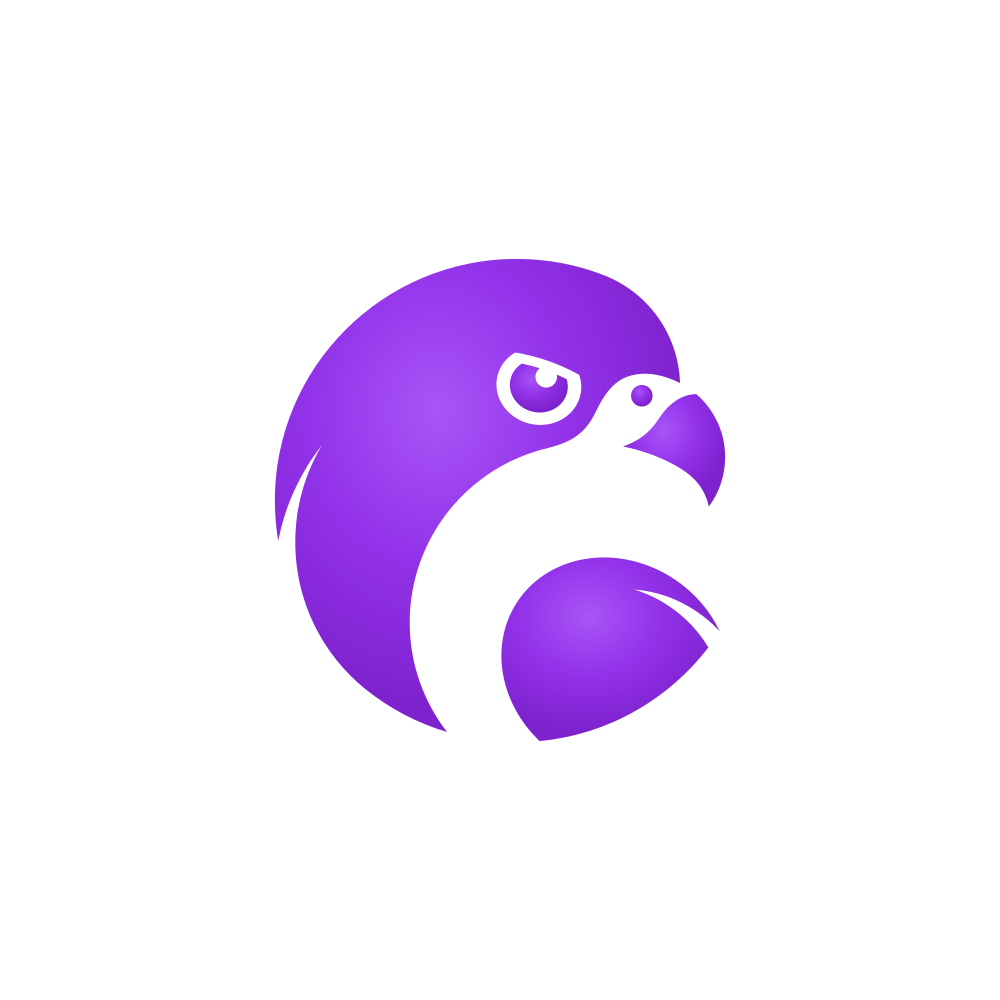
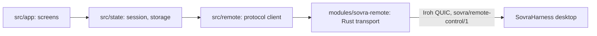

<p align="center">
  
</p>

<h1 align="center">SovraiOS</h1>

<p align="center">
  Use Sovra on your computer from your iPhone.<br>
  Built with Expo and React Native, with a Rust transport shared with Android.
</p>

<p align="center">
  <a href="#quick-start">Getting started</a>
  ·
  <a href="docs/README.md">Documentation</a>
  ·
  <a href="https://github.com/Sovra-AI/SovraHarness">SovraHarness</a>
  ·
  <a href="https://github.com/Sovra-AI/SovraAndroid">SovraAndroid</a>
  ·
  <a href="CONTRIBUTING.md">Contributing</a>
  ·
  <a href="CHANGELOG.md">Changelog</a>
</p>

Pair once by scanning a code shown by [SovraHarness](https://github.com/Sovra-AI/SovraHarness)
on your computer. After that, opening the app connects to that computer by itself, on the
same Wi-Fi or over mobile data, end-to-end encrypted.

> **License:** Source on `main` is available under Sovra's Sustainable Use License.
> This is fair-code: source-available, and not an OSI open-source license.
> Enterprise files have separate terms. See [License](#license).

## What you can do

- **Chat:** read the conversation as bubbles with Sovra's formatting, write a message that
  is typed through Sovra's real chat box, pick `/` skills, and press **Stop**.
- **Chats:** browse every chat in Sovra's sidebar, search, show older chats, or start a
  new one.
- **Skills:** search Sovra's `/` skills; picking one starts a message with it.
- **Computer:** jump to Sovra's pages, see a live picture of its window or a list of its
  controls, press keyboard keys, and type into any box there.

The app controls the Sovra window only, not your operating system, files, or shell. The
native Android app with the same screens is [SovraAndroid](https://github.com/Sovra-AI/SovraAndroid).

## Quick start

### Use the app

No App Store or TestFlight build is published yet; [build from source](#build-from-source).

1. On your computer, in Sovra: **Skills → Use Sovra from your phone** (or `/remote-control`).
2. In the app: **Scan the code**, or scan it with the iPhone camera; the `sovra://` link
   opens the app. The code works once and expires after five minutes.
3. Next time, just open the app. If it says **Turn on phone control** or **Open Sovra on
   your computer**, run the skill again: phone access switches off whenever Sovra restarts.
   Your phone stays paired.

To revoke a phone, choose **Forget** for it in Sovra on your computer. **Settings → Forget
this computer** on the phone only removes the computer from the phone.

### Build from source

The app contains a native Rust module, so it needs a **development build**; Expo Go cannot
load it. You need macOS with Xcode, Node.js 20+, and Rust through rustup with the iOS targets:

```sh
git clone https://github.com/Sovra-AI/SovraiOS.git
cd SovraiOS
rustup target add aarch64-apple-ios aarch64-apple-ios-sim
npm install
npm run native:ios    # build the Rust transport and regenerate its bindings
npm run ios           # expo run:ios: dev build on a simulator or device
npm start             # Metro, for an already installed dev build
```

Running on a physical iPhone needs an Apple developer team that can sign the build. The
same code also builds for Android (`npm run native:android && npm run android`, with the
Android SDK, NDK 27 and `cargo-ndk`); see [Development](docs/development.md).

## Status and data boundaries

The app is under active development. Read the [changelog](CHANGELOG.md) for changes and
the [documentation](docs/README.md) for current behavior.

- The phone talks only to the computer it paired with. It uses Iroh QUIC with that
  computer's key pinned, directly or through Iroh's encrypted relays, so relays and address
  lookup see connection metadata but not content.
- The pairing link is a single-use bearer invitation. The app never stores, logs, or
  routes it, and clears it from the clipboard after pasting.
- The phone key lives in the iOS Keychain on this device only, excluded from backups.
- The app works only while it is open on screen. It cannot wake a closed app or a sleeping
  computer, and there are no push notifications.
- Replies are read from the labels Sovra gives each message, so they show as text with
  Sovra's formatting. Desktops without those labels fall back to a picture of the
  conversation where they can capture one.

See [Security](SECURITY.md) for reporting and the
[desktop phone-control contract](https://github.com/Sovra-AI/SovraHarness/blob/main/docs/remote-control.md)
for the protocol.

## Development

| Command | Purpose |
| --- | --- |
| `npm run ios` | Development build and launch on iOS |
| `npm start` | Metro for an installed development build |
| `npm run native:ios` | Rebuild the Rust transport and its bindings for iOS |
| `npm run check` | TypeScript, ESLint, Jest, and `cargo test`; must pass before every commit |
| `npm run doctor` | Check Expo SDK compatibility |

See [CONTRIBUTING.md](CONTRIBUTING.md) for the pull request workflow and
[AGENTS.md](AGENTS.md) for engineering rules. To test against a real desktop, follow
[Desktop interop tests](interop/README.md).

### Architecture

Protocol decisions are pure TypeScript in `src/remote/` and are tested by Jest. The Rust
module only moves bytes. Screens render state from `src/state/`.



Read [Architecture](docs/architecture.md) for the layers and the rules the client enforces.

## Documentation

| Guide | Covers |
| --- | --- |
| [Development](docs/development.md) | Prerequisites, builds, checks, and the project layout |
| [Architecture](docs/architecture.md) | Layers, protocol rules, pairing, chat, and known limits |
| [Theming](docs/theming.md) | Sovra tokens ported from the desktop and mobile adaptations |
| [Desktop interop tests](interop/README.md) | Tests against the real desktop endpoint and runtime |
| [Documentation index](docs/README.md) | All guides |

## Contributing and support

Bug reports, feature requests, documentation improvements, and code contributions are
welcome. Search [existing issues](https://github.com/Sovra-AI/SovraiOS/issues) before
opening a new one, and follow [CONTRIBUTING.md](CONTRIBUTING.md) when submitting a pull
request. Include your app commit, iOS version, desktop version, and reproduction steps;
remove pairing links, credentials, and personal data from logs and screenshots.

Follow the [Code of Conduct](CODE_OF_CONDUCT.md) in project spaces. Report
vulnerabilities using [SECURITY.md](SECURITY.md), without posting exploit details in
public issues.

## License

[LICENSE](LICENSE) is Sovra's Sustainable Use License, Version 1.0, with Sovra as the
licensor. This is a fair-code license with use and distribution restrictions, not an OSI
open-source license. It applies to source on `main`; the license excludes other branches.
Files with `.ee.` in their name or `.ee` in their directory name are covered separately by
[LICENSE_EE.md](LICENSE_EE.md). Third-party components retain their own licenses.
