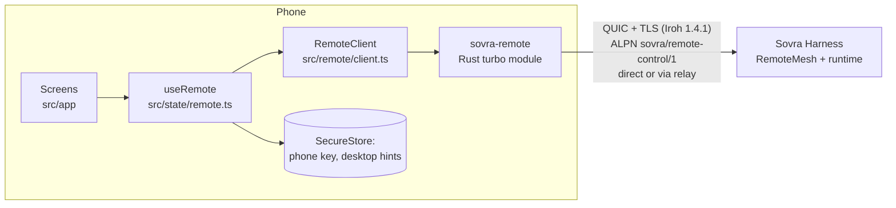

# Architecture

The desktop owns the contract: [`SovraHarness/docs/remote-control.md`](../../SovraHarness/docs/remote-control.md),
`crates/sovra-core/src/remote_control/` and the reference client
`crates/sovra-runtime/src/remote_reference.rs`. This app implements its phone side.

## Layers

| Layer | Owns | Must not |
| --- | --- | --- |
| `modules/sovra-remote/rust` | Iroh endpoint with the phone key; dial a pinned desktop key; one JSON message per bidirectional stream; size limits and transport deadlines | Make protocol decisions, retry, or persist anything |
| `src/remote/` | Wire types, strict ticket parsing, Hello/session/sequence, revision-guarded mutations, the chat flow | Touch React, storage or the network directly (takes a `PhoneTransport`) |
| `src/state/` | Lifecycle (foreground only), backoff, error → recovery mapping, persistence | Parse desktop messages to decide behaviour (codes only) |
| `src/app/`, `src/components/` | Rendering and input | Hold protocol state |

## Protocol rules the client enforces

- **Hello first.** Every new connection sends Hello; the returned generation and session
  are kept in memory only, and the sequence restarts at 1. It is consumed before sending,
  even if the request fails — exactly like the desktop's `SessionGuard`.
- **Session renewal** after 4096 requests (`MAX_SESSION_REQUESTS`).
- **Inspect before every mutation.** The desktop's revision is a hash of the whole snapshot,
  so any change (a streaming reply) invalidates it. `act()` inspects, re-finds the control,
  then sends the input with that fresh revision. Targets are discarded on reconnect; a
  control is re-found by its exact label and role only if that match is unique.
- **Only `stale_observation` is retried** (up to 4 times), because the desktop rejects it
  before delivering anything.
- **Reads reconnect once; mutations never do.** A lost reply to a mutation is
  `outcome_unknown` — the app says so and never replays it.
- **Unreachable ≠ revoked.** Only `not_paired` sends the person back to pairing.
- **Foreground only.** The mirror refreshes every 2 s while the remote screen is visible
  (which also keeps the desktop's 5 s idle timer from closing the connection). Leaving the
  screen or backgrounding the app closes the endpoint. Reconnects use 1–30 s exponential
  backoff with jitter.
- **One request in flight.** All calls are serialized through one queue.

## Pairing and secrets

- The phone key is 32 random bytes from Rust (`SecretKey::generate`), stored with
  `AFTER_FIRST_UNLOCK_THIS_DEVICE_ONLY`; Android backup is disabled. It never leaves the phone.
- The QR link is a bearer invitation. It is decoded in memory, sent once inside the
  encrypted channel and dropped. It is never stored, logged, put in navigation state, or
  left on the clipboard (the paste flow clears it).
- The desktop key from the QR is pinned: Rust checks the TLS identity matches before any
  request, and the client checks again.
- Only public routing hints (`PeerAddress`) and a display name are saved after pairing.
  Corrupt saved data fails closed (treated as unpaired).
- Pair retries send Hello first, so a lost `paired` reply never needs a new QR.

## Known limits

- Inspect exposes accessibility metadata, not all rendered text. Assistant replies are
  readable on the phone only when the desktop exposes them as labels; otherwise enable
  screenshots (unavailable on some desktop renderers, including the current Linux one).
- The app cannot wake a closed phone app or a sleeping computer. Push notifications need an
  operated APNs/FCM service and are out of scope (see the desktop contract).
- iOS builds were not produced in this environment (Linux). The iOS glue is generated and
  must be built on macOS.
