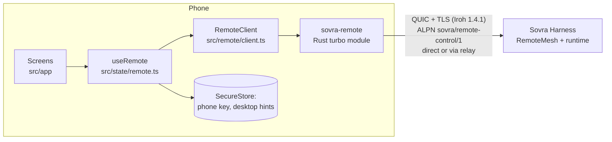

# Architecture

The desktop owns the contract: [`SovraHarness/docs/remote-control.md`](../../SovraHarness/docs/remote-control.md),
`crates/sovra-core/src/remote_control/` and the reference client
`crates/sovra-runtime/src/remote_reference.rs`. This app implements its phone side.

## Layers

| Layer | Owns | Must not |
| --- | --- | --- |
| `modules/sovra-remote/rust` | Iroh endpoint with the phone key; dial a pinned desktop key; one JSON message per bidirectional stream; size limits and transport deadlines | Make protocol decisions, retry, or persist anything |
| `src/remote/` | Wire types, strict ticket parsing, Hello/session/sequence, revision-guarded mutations, the chat flow | Touch React, storage or the network directly (takes a `PhoneTransport`) |
| `src/state/` | Lifecycle (foreground only), backoff, error → recovery mapping, persistence | Parse desktop messages to decide behaviour (codes only) |
| `src/app/`, `src/components/` | Rendering and input | Hold protocol state |

## Protocol rules the client enforces

- **Hello first.** Every new connection sends Hello; the returned generation and session
  are kept in memory only, and the sequence restarts at 1. It is consumed before sending,
  even if the request fails — exactly like the desktop's `SessionGuard`.
- **Session renewal** after 4096 requests (`MAX_SESSION_REQUESTS`).
- **Inspect before every mutation.** The desktop's revision is a hash of the whole snapshot,
  so any change (a streaming reply) invalidates it. `act()` inspects, re-finds the control,
  then sends the input with that fresh revision. Targets are discarded on reconnect; a
  control is re-found by its exact label and role only if that match is unique.
- **Only `stale_observation` is retried** (up to 4 times), because the desktop rejects it
  before delivering anything.
- **Reads reconnect once; mutations never do.** A lost reply to a mutation is
  `outcome_unknown` — the app says so and never replays it.
- **Unreachable ≠ revoked.** Only `not_paired` sends the person back to pairing.
- **Foreground only.** The mirror refreshes every 2 s while the remote screen is visible
  (which also keeps the desktop's 5 s idle timer from closing the connection). Leaving the
  screen or backgrounding the app closes the endpoint. Reconnects use 1–30 s exponential
  backoff with jitter.
- **One request in flight.** All calls are serialized through one queue.

## Pairing and secrets

- The phone key is 32 random bytes from Rust (`SecretKey::generate`), stored with
  `AFTER_FIRST_UNLOCK_THIS_DEVICE_ONLY`; Android backup is disabled. It never leaves the phone.
- The QR link is a bearer invitation. It is decoded in memory, sent once inside the
  encrypted channel and dropped. It is never stored, logged, put in navigation state, or
  left on the clipboard (the paste flow clears it).
- The desktop key from the QR is pinned: Rust checks the TLS identity matches before any
  request, and the client checks again.
- Only public routing hints (`PeerAddress`) and a display name are saved after pairing.
  Corrupt saved data fails closed (treated as unpaired).
- Pair retries send Hello first, so a lost `paired` reply never needs a new QR.

## Chat on the phone

The remote screen has four tabs: **Chat**, **Chats**, **Skills** and **Computer**.

- **Sending** goes through Sovra's real composer (`MultilineTextInput` "Message Sovra"),
  never a search or filter box. If the desktop is elsewhere (Settings, Skills…), the phone
  first presses the sidebar **Chat** control (exact label; "Chats" is the conversation
  filter), inspects again, then types. It clears the box first (`secondary-a`, Backspace),
  so the phone's text is the whole message. Each step is a separate revision-guarded mutation.
  The Chat tab also brings Chat up on the computer when another page is open, once per visit.
- **Stop** only matches whole labels ("Stop generating" / "إيقاف التوليد", or "Stop").
  Sovra has other "Stop …" buttons — "Stop phone control", "Stop sharing" — that must
  never be pressed as "stop work".
- **Reading the conversation:** the desktop labels each message — `Comment` for yours,
  `Article` for Sovra's — inside the `Log` "Conversation", so the Chat tab shows native
  bubbles (`src/remote/desktop.ts`). "Show earlier messages" appears only when the first
  bubble starts above the Log, and scrolls the conversation there. Older desktops without
  those labels fall back to a cropped screenshot of the conversation, or labelled text.
- **`/` skills** (`src/remote/skills.ts`): typing `/` in Sovra's chat box opens a menu
  whose buttons are labelled "/name. description <hint>" — every enabled skill, including
  rows scrolled out of view. The phone reads it once (type `/`, inspect, clear the box) and
  offers the same ranking as the desktop. Choosing a skill shows it as a chip; the message
  sent is `/name words`. A lone `/name` gets a trailing space, because with the menu open
  Enter only completes the name; with the space, Enter runs it. Skills whose hint is
  `<…>` need words, so Send waits for them. Sovra's refusal ("Usage: /table <what to
  present>") is an `Alert` (needs the matching SovraHarness change) and is shown in plain
  words, only after the phone's own `/` send. A skill that opens a page (`/models`) moves
  the phone to the Computer tab.
- **Chats:** the sidebar's "Open conversation …" buttons are the chat list. Sovra renders
  only rows near its visible list, so the phone also lists the ones just outside it, keeps
  every title seen while browsing, and **Show older chats** scrolls the list there. Opening
  a row scrolls it into view (over a fully visible row) first, because Inspect reports
  unclipped bounds; a chat that is not rendered at all is found with "Search chats", which
  is cleared again afterwards. Search on the phone types into that box. **New chat**
  presses "Start a fresh conversation".
- **Skills tab:** the same `/` list, searchable; choosing one starts a chat message with it.
- **Computer:** shortcuts to Sovra's sidebar pages (buttons laid out exactly like "Chat":
  Team, Artifacts, Schedules, Groups, Models, Settings…), a pinch-to-zoom picture of the
  window or a list of its controls (the open page's first, in plain words), keyboard keys,
  and a typing bar for any box tapped there. The tab fetches a fresh screenshot each
  refresh while open; a picture is never kept once screenshots stop.

## Known limits

- Reading replies needs desktop screenshots (unavailable on some desktop renderers,
  including the current Linux one); without them only labelled text is shown.
- Re-pairing a phone the desktop already remembers (e.g. after **Forget this computer** on
  the phone only): Hello proves access, then the phone still sends Pair with the code so the
  desktop closes it. Desktops older than the matching SovraHarness change refuse that Pair
  (`DuplicatePhone`) and keep the code open, pausing control (`busy`) until it expires.
- The app cannot wake a closed phone app or a sleeping computer. Push notifications need an
  operated APNs/FCM service and are out of scope (see the desktop contract).
- iOS: `libc` is pinned to 0.2.189 (0.2.190+ breaks netdev on iOS) and the `sovra-remote`
  config plugin links `SystemConfiguration`, which the static Rust library needs.
